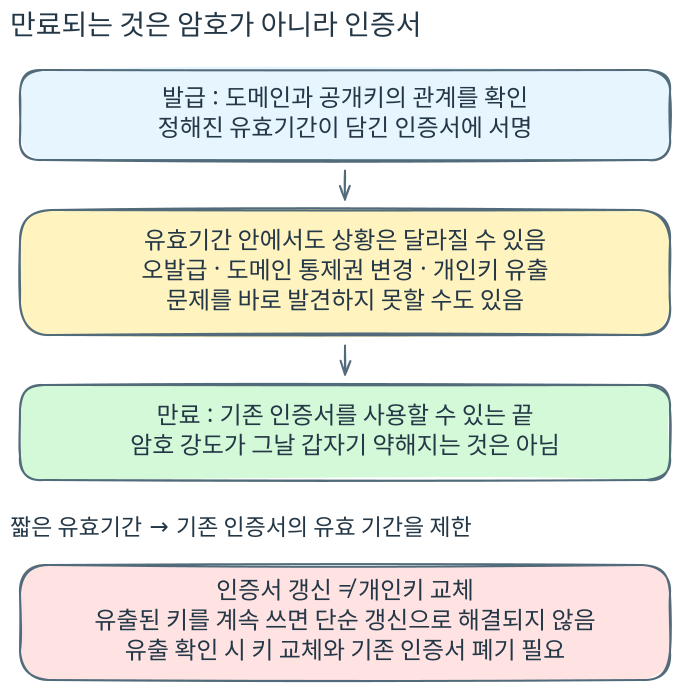
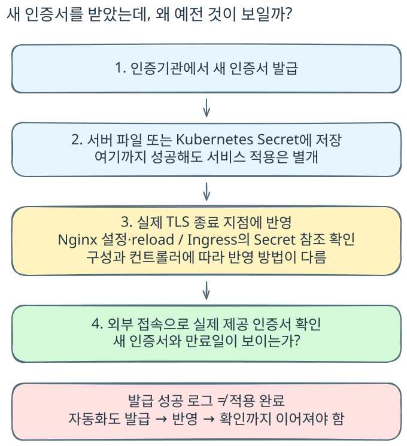

서비스는 그대로인데, 브라우저가 접속을 막습니다. 서버가 내려간 것도 아니고 방금 배포한 코드가 잘못된 것도 아닙니다. 인증서가 만료된 것입니다.

인증서를 수동으로 관리하면 만료일도 직접 챙겨야 합니다. 다른 작업을 하다 갱신 시기를 놓치면, 정상적으로 돌아가는 서비스 앞에 인증서 오류 화면이 먼저 나타납니다. 만료 전에 알아차렸더라도 여유가 얼마 남지 않았다면 인증기관에서 새 인증서를 발급받고 서버에 적용하는 일을 서둘러야 합니다.

그런데 새 파일을 올렸다고 바로 끝나지도 않습니다. 분명 인증서를 교체했는데 외부에서 접속하면 이전 인증서가 보입니다. 다시 서버에 들어가 설정이 가리키는 파일을 확인하고, Nginx reload가 제대로 반영됐는지 살펴봅니다. 발급받은 파일의 만료일이 아니라, 서버가 실제로 내보내는 인증서의 만료일이 바뀌어야 끝나는 작업입니다.[^nginx]

저는 인증서를 직접 갱신해 적용하는 방식과 자동화해서 운영하는 방식을 모두 경험했습니다. 자동화하면 이런 일을 매번 손으로 처리할 필요는 줄어듭니다. 하지만 직접 관리할 때 느꼈던 의문은 남습니다.

**도메인도 서버도 그대로인데, 왜 잘 쓰던 인증서를 주기적으로 다시 발급받아야 할까요?** 만료일만 없다면 이 일을 반복하지 않아도 되는 것 아닐까요?

## 1. 만료일이 지났다고 암호가 갑자기 약해지지는 않는다

만료일을 넘겼다고 서버의 개인키가 사라지거나, 같은 알고리즘과 키의 암호 강도가 그날 갑자기 떨어지는 것은 아닙니다. 그래서 운영하는 입장에서는 더 납득하기 어렵습니다. 같은 서버가 같은 키를 가지고 있는데 날짜 하나 때문에 연결이 막히는 것처럼 보입니다.

인증서의 유효기간은 암호가 작동하는 기간과 다릅니다. 인증기관이 확인한 도메인과 공개키의 관계를 언제까지 인정할지 정한 기간입니다. 클라이언트는 인증서의 서명과 접속 주소뿐 아니라 현재 시점이 그 기간 안에 있는지도 검증합니다. 만료된 인증서는 이 조건을 충족하지 못합니다.[^pkix]

물론 새로운 공격이나 기술 발전으로 암호 방식 자체의 안전성 평가가 달라질 수는 있습니다. 여기서 구분하려는 것은 인증서에 적힌 만료일이 그 변화의 시점을 뜻하지는 않는다는 점입니다.

## 2. 신뢰하는 기관이 잘못 발급했을 수도 있다

잘못된 인증서라면 브라우저가 경고해줄 것 같지만, 항상 그렇지는 않습니다. 신뢰하지 않는 기관이 만든 인증서와 신뢰하는 기관이 잘못 발급한 인증서는 다릅니다.

공격자가 자신의 공개키로 `example.com`의 인증서를 신청했고, 인증기관이 도메인 통제권을 잘못 확인해 발급했다고 생각해보겠습니다. 인증서에는 실제로 신뢰하는 기관의 서명이 붙어 있고, 접속하려는 도메인도 맞습니다. 공격자는 그 공개키에 대응하는 개인키도 가지고 있습니다.

공격자가 연결을 가로채는 등 자신에게 접속하게 할 수 있는 상황에서, 유효기간과 다른 검증 조건까지 충족한다면 브라우저는 그 인증서를 받아들일 수 있습니다. 브라우저가 인증기관의 발급 심사를 처음부터 다시 하는 것은 아니기 때문입니다. 이것이 ‘인증서가 오발급됐을 수 있다’는 말의 의미입니다. 공격자가 정상 서버의 인증서를 복사한 경우와는 다릅니다.[^pkix][^br]

오발급이 확인되면 해당 인증서를 폐기하는 등의 대응이 필요합니다. 다만 발견하지 못한 오발급이라도 유효기간이 끝나면 그 인증서를 정상적으로 사용할 수 없습니다. 만료는 처음의 판단이 잘못됐을 가능성에 대해서도 기한을 둡니다.[^le]

## 3. 오래전에 확인한 관계가 지금도 같다는 보장은 없다

발급이 정상적으로 이뤄졌더라도 시간이 지난 뒤에는 상황이 달라질 수 있습니다. 도메인의 통제권이나 조직 정보가 바뀔 수 있고, 인증서를 발급받았던 주체가 계속 같은 권한을 가지고 있다는 보장도 없습니다.

운영자는 자신의 서버가 그대로라는 것을 알고 있습니다. 하지만 인증기관과 클라이언트가 모든 서비스의 상태를 계속 알고 있는 것은 아닙니다. 인증서를 무기한 쓸 수 있다면 오래전에 확인한 관계를 끝없이 인정하게 됩니다.

그래서 인증서에 유효기간을 두고, 새 인증서를 발급할 때에는 정해진 검증과 검증 정보 재사용 조건을 적용합니다. 매번 모든 서류와 검증을 처음부터 반복한다는 뜻은 아니지만, 과거에 확인했다는 사실만으로 영구적인 권한을 부여하지는 않습니다.[^pkix][^br]

갱신은 기존 파일의 날짜를 고치는 일이 아니라 새 유효기간이 담긴 인증서를 발급받는 일입니다. ‘내 서버는 바뀌지 않았는데’라는 운영자의 관점과 ‘과거의 확인을 언제까지 인정할까’라는 검증자의 관점이 여기서 갈립니다.

## 4. 인증서는 공개돼도 되지만, 개인키 유출은 모를 수 있다

인증서는 원래 공개 자료입니다. 인증서가 인터넷에 오래 노출됐다는 이유만으로 비밀이 새어나간 것은 아닙니다. 비밀로 관리해야 하는 것은 그 인증서의 공개키에 대응하는 개인키입니다.

개인키가 유출되면 공격자가 그 키로 인증 과정에 참여할 수 있습니다. 유출 사실을 알아차렸다면 키를 교체하고 기존 인증서를 폐기하는 등 대응해야 합니다. 새 인증서를 받더라도 같은 개인키를 계속 사용하면, 이미 유출된 키의 문제까지 해결되는 것은 아닙니다.

문제는 유출을 바로 알지 못할 수도 있다는 점입니다. 운영자가 문제가 없다고 생각하는 동안에도, 공격자가 확보한 키와 아직 유효한 인증서를 사용할 여지가 남습니다.

유효기간을 짧게 두면 유출을 발견하지 못했더라도 기존 인증서가 유효하게 남는 기간을 제한할 수 있습니다. 폐기는 발견한 문제에 대응하고, 만료는 발견 여부와 관계없이 그 인증서를 사용할 수 있는 끝을 정해둡니다.[^le]

다만 짧은 인증서로 갱신하는 것과 개인키를 교체하는 것은 별개입니다. 유출된 같은 키로 새 인증서를 계속 발급받거나 공격자가 새 인증서까지 확보할 수 있다면, 기존 인증서가 만료된다는 사실만으로 공격이 끝나지는 않습니다. 유효기간 단축은 위험을 줄이는 장치이지 유출 대응을 대신하는 해결책은 아닙니다.

이렇게 보면 주기적인 갱신은 ‘암호가 약해져서’만 하는 일이 아닙니다. 잘못 발급되거나 현재 상태와 맞지 않거나, 유출된 키에 연결된 인증서를 오래 인정하지 않기 위한 제한입니다. 여기서 한 걸음 더 나아가면 다음 질문이 생깁니다. 그렇다면 인증서의 유효기간을 지금보다 더 짧게 두는 것이 낫지 않을까요?

## 그런데 유효기간을 더 줄인다고?

여기까지 이해하더라도 수동 관리자의 반응은 다를 수 있습니다. 이미 갱신할 때마다 신경 쓸 일이 있는데, 기간을 더 줄이면 그 일을 더 자주 해야 합니다.

실제로 방향은 더 짧은 쪽입니다. Let’s Encrypt는 2026년 10월 7일, 2027년 2월 10일부터 기본 인증서 유효기간을 90일에서 64일로 줄이겠다고 발표했습니다. 기본 유효기간은 2028년에 45일로 더 줄일 예정입니다.[^le]

64일 변경은 그 날짜 이후 발급·갱신하는 기본 인증서에 적용됩니다. 기존에 발급한 유효한 인증서를 일괄 폐기하는 것은 아닙니다. 이미 더 짧은 45일 또는 6일 프로필을 선택했다면 그 경우는 별도입니다.

공개 TLS 서버 인증서의 업계 최대 허용 기간도 줄어듭니다. CA/Browser Forum의 SC081 일정은 단계적으로 기간을 줄여 2029년에 최대 47일로 제한합니다. 이 47일은 업계의 상한이고, Let’s Encrypt의 64일·45일은 해당 기관의 발급 정책입니다.[^cab]

Let’s Encrypt가 설명하는 이유는 개인키 유출과 오발급의 위험을 줄이는 것입니다.[^le] 운영자가 잊지 않고 교체하는 데 자신이 있더라도, 정책은 개별 운영자의 사정만을 기준으로 정해지지 않습니다.

결국 운영의 전제가 바뀝니다. 한 번 발급받아 오래 쓰고, 만료가 가까워지면 담당자가 교체하는 방식으로는 반복 작업의 부담이 커집니다. 인증서가 오래 유지되는 것보다, 새 인증서를 발급받고 적용하는 과정이 계속 안정적으로 돌아가도록 만드는 일이 중요해집니다.

## 손으로 하던 일을 자동화하면 끝일까?

수동으로 관리할 때는 만료일을 챙기는 것뿐 아니라, 발급과 적용이 각각 끝났는지를 확인하는 일이 남습니다. 자동화는 이 반복을 줄이는 방법입니다. 다만 만료 자체를 없애는 것은 아닙니다. 사람이 하던 갱신을 시스템이 계속 수행하도록 바꾸는 것입니다.

AWS 인프라에서는 ACM에서 발급받은 인증서를 로드밸런서나 CloudFront에 연결하고, 조건을 충족하면 관리형 갱신을 사용할 수 있습니다. 이런 구성에서는 인증서 파일을 직접 교체할 일이 줄어듭니다. 그렇다고 AWS에 서버가 있다는 이유만으로 모든 인증서가 자동 갱신되는 것은 아닙니다. ACM에 외부 인증서를 가져온 경우 등은 구분해서 봐야 합니다.[^acm]

직접 운영하는 서버에서는 ACME 클라이언트를 스크립트와 스케줄러로 실행할 수도 있습니다. Kubernetes에서는 cert-manager를 사용하고, Route 53 같은 DNS 서비스와 연동해 DNS-01 챌린지를 처리하는 구성도 가능합니다. DNS-01은 검증용 TXT 레코드로 도메인 통제권을 증명하는 방식입니다. Route 53은 여기에서 DNS 레코드를 관리하는 역할이지 인증서를 발급하는 인증기관이 아닙니다.[^dns01][^route53]

어떤 방식을 쓰든 처음의 상황으로 돌아가볼 필요가 있습니다. 새 인증서를 받았는데 서버는 이전 인증서를 내보내는 문제입니다. 자동화해도 발급 단계만 성공하고 적용 단계가 빠지면 같은 일이 생깁니다.

Nginx라면 설정이 사용하는 파일과 reload 결과를 확인합니다. cert-manager라면 갱신된 인증서가 저장된 Secret을 실제 Ingress나 TLS 종료 구성에서 사용하는지 확인합니다. 스크립트라면 발급 뒤 파일 배포와 서비스 반영까지 이어지는지 살펴봅니다. 도구 안에서 성공한 것과 외부에서 새 인증서를 받는 것은 같은 확인이 아닙니다.[^nginx][^certmanager]

Let’s Encrypt는 ARI(ACME Renewal Info)를 지원하는 자동 갱신 클라이언트가 기관에서 안내하는 갱신 시점을 활용할 수 있다고 설명합니다. 예전 인증서 수명을 전제로 갱신 날짜를 고정했다면 그 설정도 점검할 대상입니다. 갱신 실패 알림과 새 인증서 적용까지 함께 챙기도록 권고합니다.[^le]

수동 갱신에서 반복하던 ‘발급받기, 적용하기, 실제 접속 확인하기’가 사라지는 것이 아닙니다. 그 절차를 자동으로 이어가고, 실패했을 때 알아차릴 수 있도록 만드는 것입니다.

## 비싼 인증서와 초록색 표시가 보장했던 것

인증서를 발급받을 때 조직 서류까지 제출했다면, 더 철저히 확인받았으니 오래 쓰거나 더 안전하게 통신할 수 있지 않을까 싶을 수도 있습니다. 여기서도 무엇을 확인했는지 나눠봐야 합니다.

DV는 도메인 통제권을, OV는 조직 정보를, EV는 더 엄격한 절차로 조직의 신원을 확인합니다. 차이는 확인하는 정보와 발급 절차에 있습니다.[^br][^ev] 같은 TLS 조건이라면 조직의 신원을 더 자세히 확인했다는 이유로 HTTP 데이터의 암호화가 더 강해지는 것은 아닙니다.[^tls]

브라우저의 초록색 표시와 자물쇠도 만료 정책과는 별개의 이야기입니다. Chrome은 2018년 HTTPS를 기본 상태로 다루기 위해 주소창의 ‘Secure’ 문구를 제거하겠다고 발표했습니다. 2019년에는 EV 조직 이름을 주소창에서 사이트 정보 화면으로 옮겼습니다. EV 표시가 기대한 만큼 안전한 판단을 돕지 못하고 혼동을 만들 수 있다는 설명이었습니다.[^ui2018][^evui]

2023년에는 자물쇠를 사이트 설정 아이콘으로 바꾸겠다고 발표했습니다. 연결이 보호된다는 뜻을 ‘이 사이트를 믿어도 된다’로 오해하는 문제가 이유였습니다. 피싱 사이트도 HTTPS를 사용할 수 있습니다.[^ui2023]

조직 검증 인증서를 더 자주 갱신하게 하려고 이런 표시를 없앴다는 인과관계는 이 공식 설명에서 확인되지 않습니다. 표시 변경은 사용자가 연결 보호와 사이트의 신뢰성을 혼동하지 않도록 하는 문제이고, 유효기간 단축은 인증서를 사용할 수 있는 시간을 줄이는 문제입니다.

## 갱신 작업이 번거로운 이유와 필요한 이유

수동으로 관리해보면 인증서 만료가 서비스에 불필요한 일을 하나 더 만드는 것처럼 느껴질 수 있습니다. 도메인도 서버도 그대로인데 새 인증서를 받아야 하고, 교체 뒤에는 실제로 반영됐는지 다시 확인합니다.

하지만 인증서가 증명하는 관계에 기한을 두지 않으면, 발급 당시의 확인을 언제까지나 믿게 됩니다. 갱신은 암호화를 새로 발명하는 작업이 아니라, 사용할 수 있는 기간이 정해진 인증서를 새것으로 이어가는 작업입니다.

자동화는 이 필요를 없애는 대신 반복을 감당하게 합니다. 수동과 자동의 차이는 누가 갱신 작업을 수행하느냐에 있지만, 운영자가 확인할 결과는 같습니다. **지금 접속한 클라이언트가 유효한 인증서를 받고 있는가.** 파일을 교체하거나 발급 성공 로그를 보는 것만으로 끝내기 어려웠던 이유도 여기에 있습니다.

## 참고 자료

[^acm]: [AWS — ACM 관리형 인증서 갱신](https://docs.aws.amazon.com/ko_kr/acm/latest/userguide/managed-renewal.html){: target="_blank" rel="noopener noreferrer" }. 관리형 갱신 대상과 조건. 가져온 인증서는 대상이 아닙니다.

[^nginx]: [Nginx — Starting, Stopping, and Reloading Configuration](https://nginx.org/en/docs/beginners_guide.html){: target="_blank" rel="noopener noreferrer" }. 실행 중인 구성에 설정 변경을 반영하는 reload.
[^dns01]: [Let’s Encrypt — 인증 방식, DNS-01](https://letsencrypt.org/ko/docs/challenge-types/){: target="_blank" rel="noopener noreferrer" }. DNS TXT 레코드를 이용한 도메인 통제권 검증.
[^route53]: [cert-manager — Route53 DNS-01 구성](https://cert-manager.io/docs/configuration/acme/dns01/route53/){: target="_blank" rel="noopener noreferrer" }. Route 53을 DNS 검증 제공자로 사용하는 구성.
[^certmanager]: [cert-manager — Certificate](https://cert-manager.io/docs/usage/certificate/){: target="_blank" rel="noopener noreferrer" }. 인증서 갱신과 Kubernetes Secret 저장.

[^pkix]: [RFC 5280 — 인증서 유효기간과 인증 경로 검증](https://www.rfc-editor.org/rfc/rfc5280.html){: target="_blank" rel="noopener noreferrer" }.
[^le]: [Let’s Encrypt — 64-Day Certificate Lifetimes Coming Feb 2027](https://letsencrypt.org/2026/10/07/64-day-certs.html){: target="_blank" rel="noopener noreferrer" }. 2026년 10월 7일 발표. 적용 일정, 단축 이유, ARI와 갱신 운영 권고.
[^cab]: [CA/Browser Forum — Ballot SC081v3](https://cabforum.org/2025/04/11/ballot-sc081v3-introduce-schedule-of-reducing-validity-and-data-reuse-periods/){: target="_blank" rel="noopener noreferrer" }. 공개 TLS 인증서의 최대 유효기간과 검증 정보 재사용 기간 단축 일정.
[^br]: [CA/Browser Forum — TLS Baseline Requirements](https://cabforum.org/working-groups/server/baseline-requirements/requirements/){: target="_blank" rel="noopener noreferrer" }. 도메인과 조직 정보의 검증 요구사항.
[^ev]: [CA/Browser Forum — Extended Validation Guidelines](https://cabforum.org/working-groups/server/extended-validation/){: target="_blank" rel="noopener noreferrer" }. EV 인증서의 조직 신원 검증.
[^tls]: [RFC 9846 — TLS 1.3](https://www.rfc-editor.org/rfc/rfc9846.html){: target="_blank" rel="noopener noreferrer" }. 암호 협상과 인증의 구분.
[^ui2018]: [Chromium — Evolving Chrome’s security indicators](https://blog.chromium.org/2018/05/evolving-chromes-security-indicators.html){: target="_blank" rel="noopener noreferrer" }. HTTPS를 기본 상태로 다루는 표시 변경.
[^evui]: [Chromium — EV UI Moving to Page Info](https://chromium.googlesource.com/chromium/src/+/HEAD/docs/security/ev-to-page-info.md){: target="_blank" rel="noopener noreferrer" }. EV 조직 이름 표시 변경의 이유와 근거 연구.
[^ui2023]: [Chromium — An Update on the Lock Icon](https://blog.chromium.org/2023/05/an-update-on-lock-icon.html){: target="_blank" rel="noopener noreferrer" }. 자물쇠를 사이트 신뢰성으로 오해하는 문제와 아이콘 변경.
